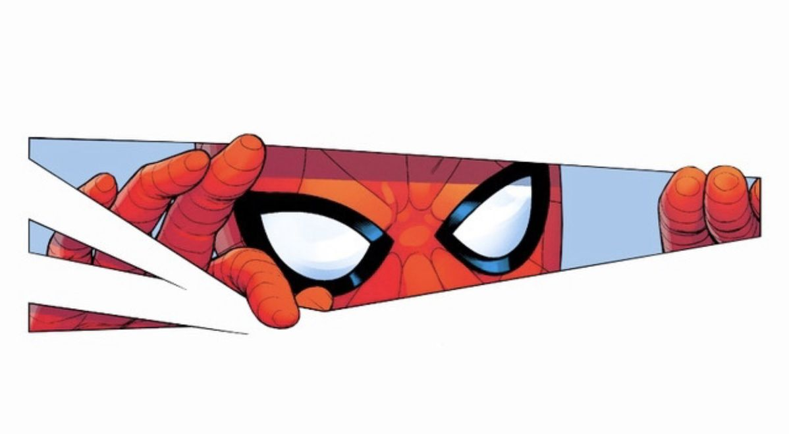

<p align="center">
  
</p>

<p align="center">
  <a href="https://fvlnzm.my"></a>
</p>

<p align="center">
  <a href="https://fvlnzm.my"></a>
  <a href="https://www.linkedin.com/in/muhammad-naufal-bin-mohd-nizam-0603b2279"></a>
  <a href="mailto:naufalnizam25@gmail.com"></a>
</p>


> **Our story so far...** Naufal finished a Computer Science diploma on the Dean's List, led a squad of iOS builders at STDCx, and is now in Semester 6 of Intelligent System Engineering at UiTM. His mission: build AI that works for every skin tone and every pair of eyes.

<details>
<summary><b>🔓 Open the classified file</b></summary>
<br />

```swift
struct Naufal {
    let role     = "Intelligent System Engineering student"
    let campus   = "UiTM Sungai Petani, Kedah 🇲🇾"
    let diploma  = "Computer Science · Dean's List"
    let building = ["DearSkin", "AccessLens"]
    let leading  = "Team leader at STDCx (iOS / SwiftUI)"
    let learning = "Python automation, one small bot at a time"
}
```

</details>


<p align="center">
  
</p>


<table>
  <tr>
    <td width="50%"><a href="https://github.com/sunquickpapi/DearSkin"></a></td>
    <td width="50%"><a href="https://github.com/sunquickpapi/dearskin-cinematic-web"></a></td>
  </tr>
  <tr>
    <td width="50%"><a href="https://github.com/sunquickpapi/JOB-SEARCH-AND-UPSKILLING-APPLICATION"></a></td>
    <td width="50%"><a href="https://github.com/sunquickpapi/Collaborative-E-Commerce"></a></td>
  </tr>
  <tr>
    <td width="50%"><a href="https://github.com/sunquickpapi/PORTFOLIO"></a></td>
    <td width="50%"></td>
  </tr>
</table>


- [ ] 🧪 **Main quest · DearSkin:** tune the skin tone model and write up the results
- [ ] ♿ **AccessLens:** AI-assisted walkway accessibility reporting
- [ ] 🏙️ **Sime Darby Property Hackathon 2026:** *Township of Tomorrow*
- [ ] 💼 **Join an internship party** · [send an invite](mailto:naufalnizam25@gmail.com)
- [x] 🎓 Finish the Computer Science diploma on the Dean's List
- [x] 📱 Lead a squad at STDCx


<p align="center">
  
  
</p>

<p align="center">
  <picture>
    <source media="(prefers-color-scheme: dark)" srcset="https://raw.githubusercontent.com/sunquickpapi/sunquickpapi/output/snake-dark.svg" />
    
  </picture>
</p>

<details>
<summary><b>🎮 Press START</b></summary>
<br />

**SECRET LEVEL FOUND! +100 XP** 🎉

You scrolled all the way down. That's the kind of curiosity I like in a teammate. Say hi at [naufalnizam25@gmail.com](mailto:naufalnizam25@gmail.com) and tell me you found the secret level.

</details>

<p align="center">
  
</p>
