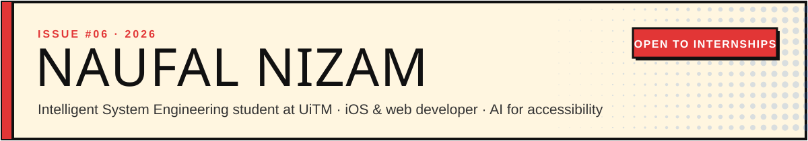
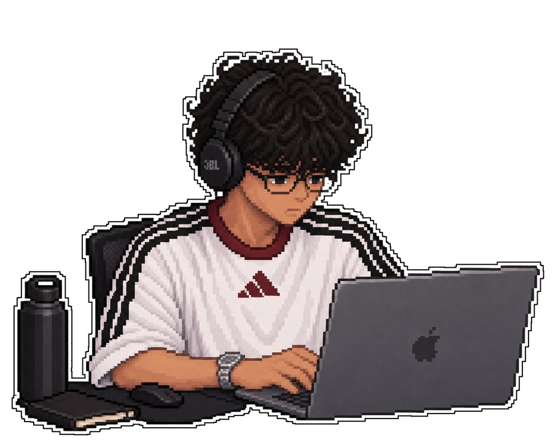
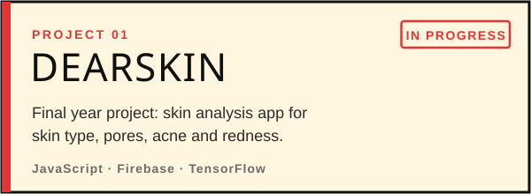
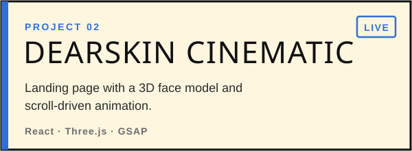
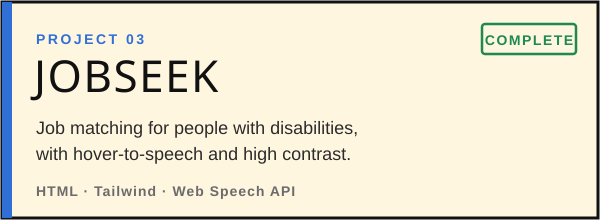
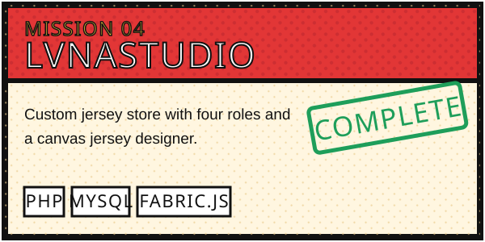
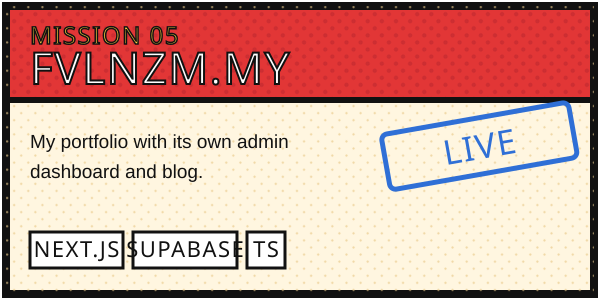
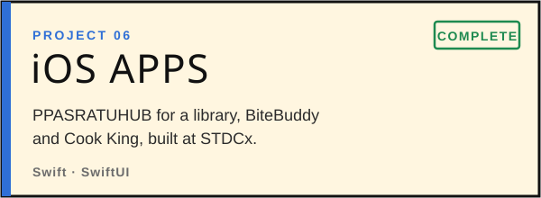
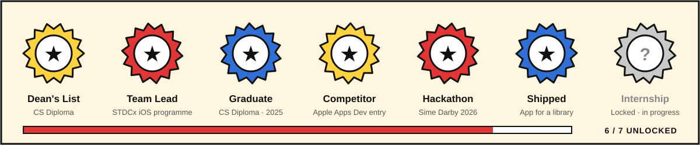

  
 
    

Technologies

                       

About Me

Hello! I'm Naufal Nizam, an Intelligent System Engineering student at UiTM. I finished my Computer Science diploma on the Dean's List and led a team of iOS builders at STDCx.

I like building apps and AI that work for everyone, from skin analysis that's fair across skin tones to tools for people with disabilities. Right now I'm sharpening my skills in Swift, SwiftUI, Next.js, Python and TensorFlow.

🧪 Currently: DearSkin (final year project), AccessLens, Sime Darby Property Hackathon 2026
📍 Based in: Sungai Petani, Kedah
💼 Status: Open to internships · get in touch
 
Projects
<table> <tr> <td width="50%"></td> <td width="50%"></td> </tr> <tr> <td width="50%"></td> <td width="50%"></td> </tr> <tr> <td width="50%"></td> <td width="50%"></td> </tr> </table>
Achievements

  

Activity

   
 
 <picture> <source media="(prefers-color-scheme: dark)" srcset="https://raw.githubusercontent.com/sunquickpapi/sunquickpapi/output/snake-dark.svg" />  </picture> 
 
 
<b>🎮 Press START</b>
  

Secret level found! +100 XP 🎉

You scrolled all the way down. That's the kind of curiosity I like in a teammate. Say hi at naufalnizam25@gmail.com and tell me you found the secret level.

 
<i>To be continued…</i>

